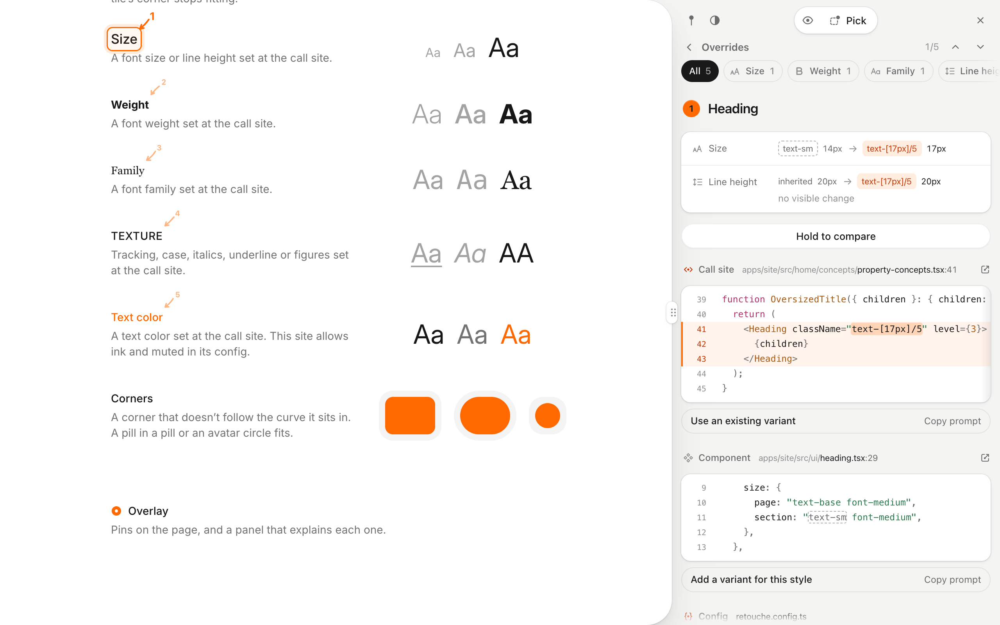

# Retouche

A dev overlay that puts a dot on every element whose call site overrides your design system's typography, and on every nested corner that doesn't follow the curve it sits in.

<p align="center">
  
</p>

```text
Set up Retouche in this React app by following https://<site>/setup.md
```

Copy the prompt from the site, give it to your coding agent in your app, then open your app on localhost.

> [!NOTE]
> Retouche is unpublished and "retouche" is a working name. The setup prompt installs it from a tarball: the one the site hosts, or one built in this repository.

`<Heading className="text-6xl">` compiles, passes review, and quietly forks the type scale. Retouche reads the rendered React tree, checks every `className` and `style` passed to the components you list, and marks each one that changes typography in place. Click a dot to see the call site, the component it overrides, and a before/after diff measured in the browser. Then decide: fix the call site, or keep the override.

## Why Retouche

- **You decide what is wanted.** Retouche reports every typography override on the components you list and does not grade them. Fix one with a copied prompt, or keep it with the `allow` entry the inspector shows and copies for you.
- **Any styling.** Tailwind utilities are read by name; any other class, from CSS Modules, plain CSS or CSS-in-JS, by the typography properties the page's stylesheets give it; inline `style` by property. Custom theme tokens need no config: `text-caption` reads as a size because the CSS Tailwind generates for it sets `font-size`.
- **Typography and corners, not layout.** Retouche watches font size, line height, weight, family, tracking, case, decoration, figures and text color. `mt-4` and `w-full` at a call site stay silent.
- **Nested corners that fit.** A button in a card's corner, an item in a popover's corner, a toolbar in a bubble menu: when its radius isn't the container's radius minus the gap between them, ±1px, a nested-corner icon points to the corner that breaks, and the finding appears under the Corners lens. The inspector shows both radii, the gap and the radius that would fit, the container's code, and a prompt that fixes the corner where the container decides it rather than in the two numbers. Circles, pills at least as round as the curve, scrolled content and fixed elements are left alone.
- **Overrides shown where they render.** Dots sit on the overridden element; the panel lists each call site once, however many elements it renders, with the class it replaced next to what replaces it, and a property chip narrows both to one property.
- **Measured, not guessed.** The diff re-renders the element without the override and reads both computed values: `text-5xl 48px → text-6xl 60px`. Hold to compare previews the page without it.
- **Code in context.** The inspector traces the override from the call site to the component's own source, with the overriding and overridden classes marked, then shows the `allow` entry that would keep it; while you hold to compare, the override is struck and the component's classes come back. Hover or focus either edge of an excerpt to reveal every line on that side in one click: the lines you were reading stay in view while the excerpt grows to show them.
- **Any element, picked, with notes for your agent.** The picker, on the bar and in the panel's head, aims at any element on the page, by pointer, by dragging a box around it, or by keyboard. Click it to write a note: each note leaves a numbered marker, and Copy all hands every note to your coding agent as markdown, with the component, its call site and component lines, its classes and its measured typography. `⌘C` copies the aimed element alone; `⇧`-click opens it in the panel: its override's inspector, or its measured typography, the classes that set it and the code that renders it.
- **Render highlights.** The render switch, at the foot of the panel, outlines each component as it renders. The component whose own state or context started the render is labelled with its name and, from its second render, how many times it rendered since the switch went on; the components its render re-rendered are outlined without a label, and only the innermost outlines are tinted. The outline stays on its element for about a second, even as the page scrolls past sticky or fixed elements, starts bright and fades as the render ages, so the latest renders stand out, and brightens again each time the component renders. While on, the switch shows how many renders the app made since then, starting from 0, so a page that isn't rendering says so. Beside it, the number of components that rendered unfolds the list of them, most renders first, each with its count and how many places it rendered in, the counts of the latest renders tinted: when the count climbs with no outline in view, the list still names who rendered, down to a component that draws nothing. Clicking one opens the element it wrote in the panel. An element opened from that list or with `⇧`-click, or an override's inspector, then shows the renders of the component that wrote it and what changed on its last render: which props, state or context, whether a new function, object or element holds the same contents as before, or nothing but its owner rendering it again. Notes taken meanwhile carry the same facts. Retouche reads React's commits itself and subscribes to none while the switch is off.
- **Sized for real pages.** Dots exist only near the viewport and a list rendered from one call site is one row, so a page with two thousand overrides scrolls at full frame rate.
- **Dev only.** In production builds `<Retouche>` renders nothing and `retouche/instrument` installs nothing; a Vite build ships neither the overlay nor the hook code. The source route answers only in development, on localhost, to requests from the app's own origin.

## Quick start

Requires React 19 and either Vite or Next.js 16 with the App Router on Turbopack, its default dev bundler.

### 1. Get the prompt

From the site: copy the one-line prompt. It points the agent at the site's `/setup.md`, which installs the tarball the site serves at `/retouche.tgz`.

From a clone of this repository:

```bash
git clone https://github.com/damien-schneider/retouche.git
cd retouche
bun install
bun run --silent prompt | pbcopy
```

`bun run prompt` builds the package, packs it into `packages/retouche/retouche.tgz`, and prints [PROMPT.md](packages/retouche/PROMPT.md) with that tarball's path filled in. `node packages/retouche/dist/cli.js prompt <tarball-url>` fills in a URL instead; the site build uses it to write `/setup.md`.

### 2. Hand it to your agent

Paste the prompt into Claude Code, Codex, Cursor or any coding agent working in your app. The agent:

1. checks the stack and installs the tarball as a dev dependency;
2. finds the design system, local or installed, and the components that style their own text or render ones that do, whatever styles them: Tailwind, CSS Modules, plain CSS, CSS-in-JS;
3. copies the [starter config](packages/retouche/templates/retouche.config.ts) to `retouche.config.ts` and lists those components;
4. wires the dev route, the instrument import and `<Retouche>`;
5. opens the app and reports how many overrides the first page shows.

### 3. Open localhost

Every overridden element in view gets a pin where its visible text ends: at the ellipsis of a truncated title, and none while a scroll area hides the element. The first pin of each call site matches the plain number beside its row in the panel; the site's other elements get a small plain dot. The floating bar counts the call sites behind them; click the count and the bar grows into the panel.

| Surface | What it shows |
| --- | --- |
| Dot | One overridden element; hover shows its number, names the component and the overriding classes, opening away from a pinned panel, and pings and lights every element from the same call site |
| Bar | The call-site count, or a check in the corner of its panel button when there is none, the dots switch and the picker; drag the grip to park it in any corner |
| Panel | Every overriding call site on the page, grouped by component, with the properties each one changes, the number of elements it renders, and the class or style it replaced next to what replaces it. The chip row counts them: All, then one chip per property that narrows the list and the dots to it. The head keeps the pin and the theme switch on its left, close on its right, and the dots switch and Pick in an island between them; the title sits below, and turns into the way back from the inspector. The chips stay above the inspector, so the head keeps its height: they show what the stepper walks through, and a chip there goes back to the list it narrows. The foot holds the render switch and, unfolded above it, the list of components that rendered since it went on, which never takes more than about half the panel |
| Inspector | The property diff, the renders of the component behind the element while render highlights are on, hold to compare, and the code traced from the call site to the component and the config, each step with the prompt that resolves the override there |
| Picker | Aim at any element with the pointer, `Tab` or the arrow keys, or drag a box around it: while you drag, the element whose box or text best fills yours is aimed, the innermost one on a near tie, and releasing picks it. The wheel still scrolls the page and the scroll area under the pointer, and the aim follows what comes under it. Click, `Enter` or the end of a drag opens a note card on it: the note field with its copy and add buttons, and tucked under it the element's name, where it is written and its lines of code, the whole element when it fits, as tall as the space above or below the element allows, with the button that opens it in the panel; hovering the code shows how many lines lie above and below, and Expand widens the card to the whole file, scrolled to the element. The card scrolls with the page while it sits by the element, and holds still on the screen once the element has scrolled out from under it. `⇧`-click, `⇧Enter` or a drag ended with `⇧` opens it in the panel directly: one inside an override opens its inspector, any other shows its computed typography, the classes behind each property, and the code from where its component is rendered to the line that renders it |
| Notes | A numbered marker on each noted element and a tray with Copy all and Clear. Click a marker to edit or remove its note. Notes last until you clear them or reload the page |

**Pin**, on the left of the panel head, docks the panel beside the page instead of over it: the page stays flush with the window and sits above the panel like a card, its two corners on the panel's side rounded into the panel, its edge lit by a hairline on the inside and casting a soft shadow onto the panel, so the seam shows against any page. Drag the seam to resize, drag the panel's header to move it to the other side. Pinning adds a margin and a scroll padding of the panel's width to `<html>` on the panel's side, so the picker's note card stays beside it. Only the two rounded corners and the hairline along the seam are drawn over the page. Elements positioned against the viewport ignore the margin, so they sit under the panel. It needs a viewport of 720px or more.

**Theme.** The overlay takes the app's light or dark theme and follows it when it switches. It reads, in order: a `dark` or `light` class or `data-theme`, `data-mode`, `data-color-mode`, `data-color-scheme` or `data-bs-theme` attribute on `<html>` or `<body>`; the `color-scheme` set on `<html>`; how dark the background painted on `<body>` or `<html>` is; then the system setting. The switch next to the pin overrides it, and the choice is kept for the site; switching back to the app's theme follows the app again. A theme set only through an inline `style` is picked up when the overlay next mounts.

**On a screen under 720px** the panel opens as a sheet across the edge the bar sits on: the bottom, or the top when the bar is parked there. Tap or drag its handle to switch between half and nine tenths of the screen, drag it away to close. The sheet adds a margin and a scroll padding to `<html>`, so the end of the page and the inspected element scroll clear of it.

| Key | Action |
| --- | --- |
| `j` / `k` | Next / previous override |
| `↑` / `↓` | Move through the list |
| `Esc` | Close the note card, leave the picker, back to the list, then close |
| `Tab` / `⇧Tab` | In the picker: aim at the next / previous element on the page, wrapping around |
| `↑` / `↓` | In the picker: aim at the parent / back at the child you climbed from, else the first child on screen |
| `←` / `→` | In the picker: aim at the previous / next sibling, wrapping around |
| `Enter` / `⇧Enter` | In the picker: note the aimed element / open it in the panel |
| `⌘C` | In the picker: copy the aimed element for your agent; in an empty note card, copy its element |
| `⌘Enter` | In the picker or a note card: save the note and copy all notes |
| `←` / `→` | On a grip: move to another corner or side. On the panel edge: resize |
| `↑` / `↓` | On the sheet's handle: move its edge up / down, between half and nine tenths of the screen |

Keys act while focus is inside Retouche.

Each step of the code trace ends with a prompt for your agent, placed where its change lands. **Use an existing variant**, under the call site, asks it to remove the override and reach the design through a variant or prop the component already has, and to stop and say which comes closest when none fits. **Add a variant for this style**, under the component, asks it to add a variant carrying the override and use it at the call site. **Allow on every** _component_, under the config, asks it to add the `allow` entry shown above it to `retouche.config.ts`, so that override stops being reported on every instance of the component. With the dev route, that entry is shown inside your `retouche.config.ts`, at the line it would take, with the file's own line numbers around it and the rest of the file a click away; when the file cannot be read or its `allow` list does not open on a line of its own, the entry is shown alone. The prompts and the entry need no dev route. In the inspector, the replaced class shows dashed, set aside rather than deleted, and the class that replaces it is tinted.

The overlay follows your edits. Save a component or a call site and the dots, the diff and the code update in place, without reopening anything. When a save removes the override you are inspecting, the inspector says so, outlines the element in green and offers the next override on the page. When the inspected element leaves the page, the panel goes back to the list. The open panel, its corner, its width, the sheet's height and the pin survive a full reload.

## Manual setup

### Vite

```ts
// vite.config.ts
import { retouche } from "retouche/vite";

export default defineConfig({
  plugins: [react(), retouche()],
});
```

```tsx
// src/main.tsx
import "retouche/instrument";
import { Retouche } from "retouche";

import config from "../retouche.config";

createRoot(root).render(
  <>
    <App />
    <Retouche config={config} />
  </>
);
```

### Next.js (App Router)

```ts
// app/api/retouche/[...path]/route.ts
export { GET } from "retouche/next";
```

```ts
// instrumentation-client.ts
import "retouche/instrument";
```

Render `<Retouche config={config} />` inside the root layout's `<body>`.

`retouche/instrument` installs React's DevTools hook before React loads, in development only. Without it, dots and code still work; the measured diff, hold to compare and render highlights do not.

## Configuration

```ts
import { defineConfig } from "retouche/config";

export default defineConfig({
  components: ["Heading", "Text", "Button"],
  allow: [
    { component: "Text", classes: ["text-muted-foreground"] },
    { component: "Button", properties: ["font-weight"] },
  ],
});
```

| Field | Purpose |
| --- | --- |
| `components` | Display names of the design-system components to watch: the ones that style their own text, and the ones that render those with classes of their own, so what they render is trusted as composition |
| `allow` | Overrides that are wanted. Each entry takes `classes` (globs on the class name, variants ignored), `properties`, `corners`, or a mix, and an optional `component`; without one it applies to every watched component. An override is let through when it matches either list, so `properties` covers classes and inline styles alike |
| `allow.*.corners` | `true` keeps the nested corners of the entry's `component` as they are |
| `allow.*.properties` | `font-size`, `font-weight`, `font-family`, `line-height`, `letter-spacing`, `font-style`, `text-transform`, `text-decoration`, `font-variant-numeric`, `font-smoothing`, `text-color` |

An invalid config pauses scanning and lists every issue in the panel.

## How it works

The client walks React's fiber tree from the DOM, finds elements rendered by a watched component, and sorts the `className` and `style` props passed at the call site by the typography property they set. Elements a watched component renders itself are the design system's own composition and are not reported, including the ones a library such as Base UI clones from an element the component handed it with the same classes and style. Tailwind classes are grouped by name, variants included, so `md:text-xl` is a font-size override that does not apply at rest. A `text-*` or `font-*` class Tailwind does not ship, such as a theme's `text-caption` or `font-book`, and any other class are resolved through the page's stylesheets: a class counts when a rule targeting it sets a watched property. Tailwind's `var(--tw-…, fallback)` declarations, which give way to any utility on the same element, do not count, so `text-caption` is a size like `text-lg`, not a size and a line height. Stylesheets from another origin cannot be read. Overrides matching an `allow` entry are dropped.

To measure, Retouche re-renders the component through React's DevTools renderer interface with the overriding props removed, reads its classes and computed styles, and restores the original props in the same task. The panel measures each row it lists, for the class the override replaced; the inspector measures the override it opens, for the values too. The dev route reads source files for the code view: the Vite plugin and the Next.js route handler share one handler, which refuses non-localhost hostnames, cross-origin requests, files outside the repository, and `node_modules`. The Vite plugin also refuses non-loopback sockets. When a library hook such as Base UI's `useRender` creates the component's element, the code view shows the component's call to it. Code written inside an installed package, such as a design system from npm, is named by its package instead. A picked element that a library part writes, such as the button of Base UI's `Select.Trigger` or a Radix `Slot`, is named by your component that renders the part, and its code starts at that component's call site in your app; a library component placed in a page as is, such as MUI's `Button`, keeps its own name.

The scan reruns about 80 ms after every React commit, so a Fast Refresh update is picked up at once, and every second otherwise. The inspector re-measures when Fast Refresh swaps the component or its call site. A CSS-only edit, such as a theme token or a CSS Module change, does not trigger a React commit: the next scan, within a second, re-reads the stylesheet classes, and reselecting the override measures its values again.

Overrides are grouped by call site, the JSX element in your source that passed the override, read from the creation stack React records for each element in development. React records those stacks for 10,000 elements a second. Past that, elements written at the same place in the same component, with the same watched component and override, share a row, so a long list stays one row; the code trace reads their call site from an element React did record there.

Dots are rendered only for elements within 600px of the viewport, or of the scroll area that holds them, so the overlay's cost follows what is on screen rather than the size of the page. On a page with 2,001 overridden elements the overlay holds 37 dots, a rescan takes about 1.3 ms and scrolling holds 60 frames a second; with 12,201 a rescan takes about 9 ms and one frame in a scroll runs long. Measured in headless Chromium at 1280×800 on a React development build with StrictMode.

Dots ride the page's own scroll natively. A scroll area inside the page scrolls on the compositor, ahead of what the overlay can measure, so while one scrolls, the dots, note markers and outlines on elements inside it scale down and fade out, and come back 150ms after it stops, even while another area, such as a streaming chat, keeps scrolling; those elsewhere stay on their text. A dot whose element scrolls out of the area stays in place, hidden, so it does not replay its entrance when the element scrolls back.

A dot, note marker or corner dot holds still while the pointer or focus is on it. Moving onto it ends the page's own hover on the element beneath, and an element that shifts or reflows on hover would otherwise carry the dot out from under the pointer; it catches up once the pointer moves on.

Render highlights subscribe to React's commits through the DevTools hook only while the switch is on. Each commit, Retouche walks the components React rendered, skipping the subtrees it bailed out of and the overlay's own, including the components that render nothing but the overlay, counts each one and keeps references to its previous and new props, state and context; what changed is worked out only when the panel or a note asks. The renders Retouche causes itself, to measure a diff or hold to compare, are left out. A component whose props object is the one it had before rendered for its own state or context; one with new props was rendered again by its owner. Each component that rendered keeps one flash for 1.2 s from its last render: one box around the elements it wrote, measured again every frame while lit, and shared by components with the same box. A box whose element held still while the page scrolled goes in a layer fixed to the screen, the others in a layer that scrolls with the page, so the browser scrolls each box the way it scrolls its element, even between frames. Only the boxes started by their component's own state or context are labelled, and only the innermost boxes are tinted. The flash fades over its 1.2 s and pulses its ring, and the tint of an innermost box, on each render; with reduced motion it holds steady instead. Labels that would overlap fold into the label of the larger box, and a box taller than the screen keeps its label at the top of the screen. A component rendered before the overlay loaded starts its count at its next render. The list at the panel's foot keeps one entry per component type rather than per instance: its renders since the switch went on, how many instances rendered, and the fiber that rendered last, so a row opens that instance's element without holding on to the ones that unmounted. It renders only the rows in view and a few around them, in a grid as tall as every row, so a list of hundreds of components scrolls like a short one.

Verified on React 19 client components with Vite, and on Next.js 16 with Turbopack, client and server components alike. Server components are detected from React's server debug info; their diff cannot be measured in the browser. Next's webpack dev server (`next dev --webpack`) is not supported: overrides are detected, but client call sites point at the compiled line and server components show no code. Frameworks other than React are out of scope.

## Local development

### Requirements

- [Bun 1.4.4](https://bun.sh/), the version pinned in `package.json`.
- Node.js, to run the CLI.

### Setup

```bash
bun install
bun run dev
```

The site runs at `http://localhost:4517`. In both local development and the static site build, the live overlay marks each Properties example as its override appears on scroll. You can hide the demo's arrows with the toolbar's dots switch; they return when you reload.

The site also hosts the setup: every dev or build run copies the packed tarball to `apps/site/public/retouche.tgz` and writes `apps/site/public/setup.md` pointing at it. In dev the origin is `http://localhost:4517`; a build takes it from `SITE_URL` and fails without it.

### Commands

| Command | Purpose |
| --- | --- |
| `bun run dev` | Pack the package and run the site with the overlay |
| `bun run build` | Build `packages/retouche/dist` |
| `SITE_URL=<origin> bun run build:site` | Pack the package, then prerender the site to `apps/site/dist/client` with `/retouche.tgz` and `/setup.md` |
| `bun run pack` | Build and pack `packages/retouche/retouche.tgz` |
| `bun run prompt` | Pack, then print the setup prompt with the tarball path |
| `bun run test` | Run the package's Vitest suite (jsdom, real React rendering) |
| `bun run typecheck` | Type-check every workspace |
| `bun run check` | Lint with oxlint, check formatting with oxfmt |
| `bun run fix` | Apply oxlint fixes, then format with oxfmt |

## Repository layout

| Path | Responsibility |
| --- | --- |
| `packages/retouche/src/rules` | Config schema, class and style grouping, allow matching, override detection, property diff, corner fit |
| `packages/retouche/src/client/fiber` | Fiber scan, call-site grouping, override stripping and measurement |
| `packages/retouche/src/client/dots` | Dot placement in document space, viewport windowing, the dots, the element outline |
| `packages/retouche/src/client/surface` | The one surface that is the bar, the panel or the narrow-screen sheet: dock geometry, pin, toolbar, the resize handle on the seam, and in `gestures/` snap drag, resize and the sheet's handle |
| `packages/retouche/src/client/panel` | Panel head and stepper, property lenses, overrides list, config issues |
| `packages/retouche/src/client/inspector` | Property diff, hold to compare, code trace, fix and allow prompts |
| `packages/retouche/src/client/picker` | Pick mode: the capture layer, keyboard aiming, drag-to-pick by area, the picked element's typography and code trace, the note card, markers, tray and the markdown copied for agents |
| `packages/retouche/src/client/corners` | Nested corner fit: the painted pairs measured near the viewport, their dots, rows, inspector block and prompts |
| `packages/retouche/src/client/renders` | Render highlights: the commit walk, the counts and what changed in `record/`, the flashes in `flashes/`, the switch and the list of components that rendered at the panel's foot in `footer/`, and the facts the panel and notes show |
| `packages/retouche/src/client/stylesheets` | Typography properties the page's stylesheets give each class |
| `packages/retouche/src/client/code` | Source excerpt with marked classes, edge expanders that reveal the rest of the file on their side, editor links |
| `packages/retouche/src/client/route` | Dev route client and its availability state |
| `packages/retouche/src/client/shell` | Shadow-DOM portal, icons, hover targets, stored preferences, widget events |
| `packages/retouche/src/client/theme` | The app's light or dark theme read from the page, the choice that overrides it, and its switch |
| `packages/retouche/src/client/styles` | Overlay CSS as strings, injected into the shadow root |
| `packages/retouche/src/server` | Dev route handler, Vite plugin, Next.js route, source reader |
| `packages/retouche/src/protocol.ts` | The client and server wire contract |
| `packages/retouche/PROMPT.md` | The setup prompt handed to agents |
| `packages/retouche/templates` | Starter config |
| `apps/site` | TanStack Start site: the promotional page and, in dev, the overlay's test bed |

## Next

- Export the same check as a Biome Grit or ESLint plugin, so CI catches the overrides the overlay shows.
